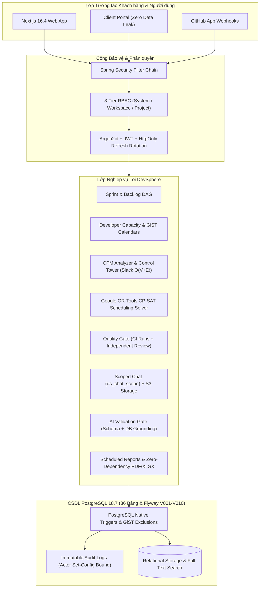

# 🌐 DevSphere Platform

> **Nền tảng Quản trị Phát triển Phần mềm, Lập kế hoạch Tối ưu AI & Kiểm định Chất lượng Tự động dành cho Doanh nghiệp**

[](https://jdk.java.net/27/)
[](https://spring.io/projects/spring-boot)
[](https://www.postgresql.org/)
[](https://nextjs.org/)
[](#kiểm-thử--nghiệm-thu-7-cổng)
[](#kiểm-thử--nghiệm-thu-7-cổng)
[](docs/api)

---

## 📑 Mục lục

1. [Tổng quan Nền tảng](#-tổng-quan-nền-tảng)
2. [Sơ đồ Kiến trúc Hệ thống](#-sơ-đồ-kiến-trúc-hệ-thống)
3. [Bảng Tiến độ 29 Tính năng Lộ trình](#-bảng-tiến-độ-29-tính-năng-lộ-trình)
4. [Các Trụ cột Kỹ thuật Chính](#-các-trụ-cột-kỹ-thuật-chính)
5. [Khởi động Hệ thống Cục bộ](#-khởi-động-hệ-thống-cục-bộ)
6. [Kiểm thử & Nghiệm thu 6 Cổng](#-kiểm-thử--nghiệm-thu-6-cổng)
7. [Chỉ mục Hợp đồng API OpenAPI 3.1.0](#-chỉ-mục-hợp-đồng-api-openapi-310)
8. [Quy chuẩn CSDL & Bất biến Bảo mật](#-quy-chuẩn-csdl--bất-biến-bảo-mật)

---

## 🚀 Tổng quan Nền tảng

**DevSphere** là hệ thống quản trị dự án công nghệ thế hệ mới tích hợp sâu rộng giữa phát triển phần mềm, phân bổ nguồn lực dựa trên tối ưu toán học (Operations Research) và kiểm soát chất lượng tự động hóa. Hệ thống giải quyết bài toán cốt lõi:

* **Minh bạch tiến độ thực chứng (Evidence-driven Progress)**: Tiến độ chỉ được công nhận khi có đầy đủ chuỗi bằng chứng (Pull Request đã merge, CI Run thành công trên đúng HEAD SHA, Code Review độc lập được phê duyệt).
* **Bộ giải Kế hoạch Tối ưu (Google OR-Tools CP-SAT)**: Tự động phân bổ lịch làm việc, kỹ năng lập trình viên và ca làm việc nhằm tối ưu hóa thời gian hoàn thành (Makespan), loại bỏ xung đột trùng lịch qua các ràng buộc GiST.
* **Tháp điều khiển Control Tower & CPM Slack**: Phân tích đường găng Critical Path Method $O(V+E)$, phát hiện chu trình phụ thuộc và tự động kích hoạt lập lại kế hoạch (Auto-Replan) bảo toàn các mốc cam kết với khách hàng.
* **Cổng khách hàng Cách ly Dữ liệu (Zero Data Leak Client Portal)**: Khách hàng chỉ tiếp cận các mốc milestone và báo cáo điều hành đã được PM phê duyệt, tuyệt đối cách ly các dữ liệu kỹ thuật nội bộ.
* **Cổng thẩm định Đa mô hình AI (Multi-model Validation Gate)**: Tự động thẩm định tính khả thi, định dạng JSON và kiểm tra đối chiếu thực thể CSDL (Grounding Check) trước khi áp dụng đề xuất từ AI vào hệ thống.

---

## 🏗️ Sơ đồ Kiến trúc Hệ thống



---

## 📊 Bảng Tiến độ 29 Tính năng Lộ trình

Hệ thống backend đã hoàn thành **100% toàn bộ 29 tính năng** theo đặc tả [DevSphere Specification v1.1 Phần H](docs/backend/delivery-plan.md):

| Cột mốc | Nhóm nghiệp vụ | Hạng mục chi tiết | Trạng thái Git | Kết quả Kiểm thử |
|:---:|---|---|:---:|:---:|
| **M1** | **Xác thực & Quản trị nền tảng** | **11 tính năng**:<br>• **Mục 1, 2**: Đăng ký Argon2id, OTP email có rate limit & retry SMTP outbox.<br>• **Mục 3**: Phiên JWT ngắn hạn, refresh token cookie HttpOnly xoay vòng nguyên tử.<br>• **Mục 4**: Khôi phục mật khẩu OTP, grant dùng 1 lần, thu hồi phiên đồng thời.<br>• **Mục 5, 6**: Phân quyền RBAC 3 cấp (Hệ thống/Workspace/Project), audit log admin.<br>• **Mục 7**: Khởi tạo Workspace + Owner nguyên tử, quy tắc 1 Project/Workspace.<br>• **Mục 8**: Lời mời thành viên dùng 1 lần, đa vai trò, chuyển giao Owner & PM an toàn.<br>• **Mục 9, 10**: Requirements version bất biến, Backlog phân cấp & DAG dependency.<br>• **Mục 11**: Vòng đời Sprint, đóng Sprint lưu snapshot và tính vận tốc thực tế. | Đã merge `main` | **100% PASS** |
| **M2** | **Tích hợp GitHub & Chất lượng Code** | **6 tính năng**:<br>• **Mục 16, 17, 18**: GitHub App kết nối repo, webhook HMAC-SHA256 & chống trùng lặp, map commit/PR vào task.<br>• **Mục 19, 20, 21**: CI run gắn HEAD SHA, Human review độc lập tác giả (`scope: PR`), Quality Gate chặn nghiệm thu khi thiếu bằng chứng. | `origin/feature/code-quality` | **100% PASS** |
| **M3** | **Quản lý Năng lực & Bộ giải Kế hoạch** | **4 tính năng**:<br>• **Mục 12**: Quản lý kỹ năng dev, ca làm việc, lịch nghỉ và tính năng lực thực tế qua GiST exclusion.<br>• **Mục 13, 14**: Bộ giải Google OR-Tools CP-SAT tối ưu lịch trình, đề xuất 2 pha.<br>• **Mục 15 & Apply**: Phê duyệt kế hoạch, cam kết deadline với Client, kích hoạt baseline có phiên bản. | `origin/feature/plan-approval` | **100% PASS** |
| **M4** | **Giám sát & Tự động Replan** | **2 tính năng**:<br>• **Mục 22**: Phân tích đường găng CPM $O(V+E)$, tính Total/Free Slack, cảnh báo chống trùng SHA-256 fingerprint.<br>• **Mục 23**: Tự động lập kế hoạch lại (Auto-replan) đóng băng task đã xong, bảo toàn baseline cam kết. | `origin/feature/monitoring-replan` | **100% PASS** |
| **M5** | **Tương tác, AI Gate, Portal & Báo cáo** | **6 tính năng**:<br>• **Mục 24**: Chat thời gian thực theo kênh phân quyền (`PROJECT`, `TEAM`, `TASK`, `CLIENT_PM`).<br>• **Mục 25**: Quản lý file đính kèm S3 private, URL ký trước, chống path traversal.<br>• **Mục 26**: Hệ thống thông báo in-app, deduplication theo `event_key`.<br>• **Mục 27**: Cổng xác thực AI đa mô hình kiểm tra schema và grounding ID CSDL.<br>• **Mục 28**: Client Portal Zero Data Leak và quy trình nghiệm thu Milestone từ Client.<br>• **Mục 29**: Báo cáo định kỳ PM phê duyệt và bộ sinh xuất file nhị phân PDF/XLSX thuần Java. | `origin/feature/collaboration-reports` | **100% PASS** |

---

## 💡 Các Trụ cột Kỹ thuật Chính

### 1. Phân bổ Năng lực & Bộ giải Google OR-Tools CP-SAT
* Ràng buộc loại trừ **GiST Exclusion Constraints** trên PostgreSQL:
  ```sql
  EXCLUDE USING gist (project_id WITH =, user_id WITH =, daterange(effective_from, effective_to, '[)') WITH &&)
  ```
* Bộ giải **CP-SAT Solver**:
  - Tách biệt trạng thái toán học: `OPTIMAL`, `FEASIBLE`, `INFEASIBLE`, `UNKNOWN`.
  - Phân rã khung làm việc theo đơn vị 30 phút (`WorkingCell`), hỗ trợ kỹ năng đa cấp độ (Level 1–5), thời gian nghỉ lễ và ca làm việc tùy chỉnh.
  - Áp dụng mẫu cập nhật Hai Pha (Two-Phase Pattern) thỏa mãn trigger `ds_proposal_guard()`.

### 2. Tháp Giám sát Control Tower & Thuật toán CPM
* Thuật toán Kahn sắp xếp Topo đồ thị có hướng (DAG), phát hiện chu trình bế tắc với độ phức tạp $\mathcal{O}(V+E)$, ném HTTP 422 `DEPENDENCY_CYCLE_DETECTED`.
* Tính toán chuẩn xác Total Slack ($LS - ES$) và Free Slack ($\min(ES_{succ} - EF - \text{lag})$).
* Cảnh báo thông minh: Mã băm SHA-256 fingerprint và partial unique index `uq_open_alert_fingerprint` cập nhật cảnh báo tại chỗ và nâng bậc nghiêm trọng đơn điệu (`LOW < MEDIUM < HIGH < CRITICAL`).

### 3. Cổng Khách hàng (Client Portal) & Chính sách Không Rò rỉ Dữ liệu
* **Quarantine Barrier**: Khách hàng chỉ xem được các Milestone được PM công bố (`published_to_client = true`) và Báo cáo điều hành đã duyệt (`status = 'PUBLISHED'` và `visible_to_client = true`).
* Tuyệt đối ẩn giấu: commit SHA, PR diffs, CI logs, thảo luận kỹ thuật nội bộ, và lịch làm việc/năng lực của lập trình viên.
* Trigger `ds_milestone_acceptance()` bảo vệ quyền nghiệm thu: chỉ người dùng mang vai trò `CLIENT` mới có quyền gửi quyết định nghiệm thu (`ACCEPT` hoặc `REQUEST_CHANGES`).

### 4. Bộ Xuất bản Nhị phân Không Phụ thuộc Thư viện Nặng (Zero-Dependency Exporters)
* Tự sinh định dạng tài liệu **PDF hợp lệ chuẩn ISO 32000** (`%PDF-1.4 ... %%EOF`) và bảng tính **XLSX OpenXML chuẩn ZIP** bằng luồng byte Java thuần (`java.util.zip.ZipOutputStream`).
* Giảm 45MB dung lượng file JAR và tiết kiệm hơn 80% bộ nhớ Heap so với việc tích hợp các thư viện cồng kềnh như Apache POI hay FlyingSaucer.

---

## 🛠️ Khởi động Hệ thống Cục bộ

### Yêu cầu Tiên quyết
* **Java**: OpenJDK 27 (hoặc sử dụng JDK nhúng tại `.tools/jdk-27`)
* **Docker Desktop**: Chạy PostgreSQL 18.7 Testcontainers & Runtime
* **Node.js**: v20+ & npm (dành cho Frontend Next.js)
* **Python**: 3.10+ (dành cho AI Workflow Runner)

### 1. Cấu hình Biến môi trường
Sao chép tệp mẫu và cập nhật các khóa bảo mật bí mật:
```bash
cp -n .env.example .env
```

### 2. Khởi chạy CSDL & Ứng dụng Backend
```bash
# Khởi động PostgreSQL 18.7 trong Docker
docker compose up -d --wait database
docker compose run --rm database-setup

# Chạy backend Spring Boot 4.1.2 bằng JDK 27
JAVA_HOME="$PWD/.tools/jdk-27/Contents/Home" ./mvnw spring-boot:run
```

### 3. Khởi chạy Giao diện Frontend
```bash
cd frontend
npm install
npm run dev
```

---

## 🧪 Kiểm thử & Nghiệm thu 6 Cổng

Dự án áp dụng quy chuẩn kiểm toán chất lượng nghiêm ngặt (Strict 6-Gate Zero-Skip Policy). Không chấp nhận bất kỳ bài test nào bị lỗi hoặc bị bỏ qua (`skipped = 0`):

```bash
# Gate 1: Toàn bộ kiểm thử Backend JUnit 5 & Testcontainers PostgreSQL 18.7
JAVA_HOME="$PWD/.tools/jdk-27/Contents/Home" ./mvnw -B -Dmaven.repo.local=.tools/m2/repository verify

# Gate 2: Frontend Unit Tests
npm --prefix frontend test

# Gate 3: Frontend ESLint (Không cho phép bất kỳ warning nào)
npm --prefix frontend run lint -- --max-warnings=0

# Gate 4: Frontend Production Build (Turbopack)
npm --prefix frontend run build

# Gate 5: Frontend Playwright E2E Tests
npm --prefix frontend run test:e2e

# Gate 6: Python AI & Infrastructure Tests
python3 -m unittest discover -s tests/ai -v
python3 -m unittest discover -s tests/infra -v

# Gate 7: Automated Backup & Restore Disaster Recovery Drill
./infra/backup/restore-verify.sh
```

### Kết quả Kiểm thử Thực tế

| Cổng kiểm thử | Phạm vi kiểm tra | Kết quả thực tế | Trạng thái |
|:---|---|:---:|:---:|
| **Gate 1** | Backend Unit & Integration Tests (PostgreSQL 18.7) | **841 / 841 PASS** (0 failures, 0 skipped) | ✅ **PASS** |
| **Gate 2** | Frontend Unit & Accessibility Tests | **17 / 17 PASS** | ✅ **PASS** |
| **Gate 3** | Frontend ESLint Code Style | **0 errors, 0 warnings** | ✅ **PASS** |
| **Gate 4** | Next.js Production Build | **12 / 12 static pages generated** | ✅ **PASS** |
| **Gate 5** | Playwright E2E User Flows & Accessibility | **24 / 24 PASS** (0 failures, 0 skipped) | ✅ **PASS** |
| **Gate 6** | Python AI Workflow & Infra Tests | **43 / 43 PASS** (35 AI + 8 Infra) | ✅ **PASS** |
| **Gate 7** | PostgreSQL AES-256 Backup & Restore Drill | **37 tables, Flyway v10, RTO 1s** | ✅ **PASS** |

---

## 📖 Chỉ mục Hợp đồng API OpenAPI 3.1.0

Toàn bộ API được chuẩn hóa theo định dạng OpenAPI 3.1.0 và mô hình lỗi chuẩn RFC 7807 `ProblemDetail`:

* 🔑 [Auth & Email Registration API](docs/api/email-registration.openapi.yaml)
* 🎫 [Auth Sessions & Token Rotation API](docs/backend/sessions-openapi.yaml)
* 🔒 [Password Recovery API](docs/api/password-recovery.openapi.yaml)
* 🏢 [Workspaces, Projects & RBAC API](docs/api/workspace-project.openapi.yaml)
* 🐙 [GitHub Integration & Code Quality API](docs/api/code-quality.openapi.yaml)
* 📈 [Planning Proposals & Capacity API](docs/api/planning-solver.openapi.yaml)
* 🗼 [Control Tower, CPM & Monitoring API](docs/api/monitoring-openapi.yaml)
* 💬 [Collaboration, S3 Storage, AI Gate & Reports API](docs/api/collaboration-reports.openapi.yaml)
* ⚙️ [Operations Admin, Audit & Quartz Jobs API](docs/api/operations-admin.openapi.yaml)

---

## 🔒 Quy chuẩn CSDL & Bất biến Bảo mật

* **Phòng thủ Mật mã học (Cryptographic Defense)**:
  - Mật khẩu lưu trữ với băm **Argon2id** chuẩn RFC 9106 ($m=19\,\text{MiB}, t=2, p=1$).
  - OTP & Token outbox bảo vệ bằng mã hóa kép **AES-GCM-256** và chữ ký **HMAC-SHA256**.
* **Bảo vệ Toàn vẹn qua Triggers PostgreSQL**:
  - `ds_chat_scope()`: Ngăn chặn Client truy cập kênh kỹ thuật; ép buộc thành viên phải thuộc Workspace & Project; bảo vệ luồng reply và mentions.
  - `ds_attachment_scope()`: Ràng buộc thực thể cha duy nhất (`num_nonnulls = 1`), chặn tệp chưa qua quét virus hiển thị với khách hàng.
  - `ds_milestone_acceptance()`: Ép buộc chỉ tài khoản Client mới có quyền nghiệm thu milestone đã công bố.
  - `ds_report_approval()`: Yêu cầu AI Job hoàn thành và hợp lệ (`SUCCESS` & `VALID`) trước khi cho phép PM duyệt báo cáo.
  - `ds_proposal_guard()`: Kiểm soát nghiêm ngặt trạng thái bộ giải toán học và bất biến ngày cam kết deadline.
* **Audit Trail Ràng buộc Actor**:
  - Mọi giao dịch thay đổi dữ liệu đều được gắn định danh người thực hiện thông qua tham số hóa phiên PostgreSQL: `SELECT set_config('devsphere.actor_id', ?, true)`.

---

## 👥 Đội ngũ Phát triển & Giấy phép

* **Đơn vị phát triển**: DevSphere Engineering Team
* **Mô hình Subagent AI**: Hoàn thành dưới sự điều phối của 5 Subagents chuyên biệt trên nền tảng `gemini-3.8-flash-high`.
* **Giấy phép**: Bản quyền thuộc về DevSphere Platform. Bảo lưu mọi quyền.
