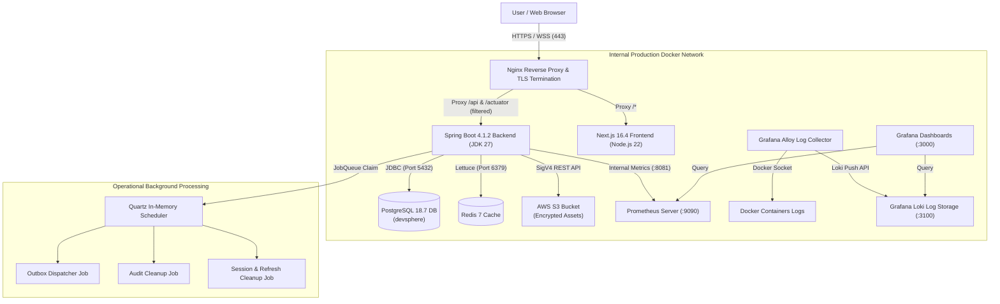

# DevSphere System Architecture & Operations Design

This document details the architectural topology, operational flows, and security boundaries implemented in DevSphere.

## High-Level System Architecture

## Key Architectural Patterns

### 1. Transactional Outbox Pattern
To prevent distributed transaction anomalies across PostgreSQL and external message sinks, DevSphere implements the Transactional Outbox pattern:
- Domain mutations write events to the `background_jobs` table within the active database transaction.
- The `OutboxDispatcherJob` runs periodically via Quartz, claiming batches with optimistic locking and exponential backoff retry logic.
- Failed events transition to dead-letter states after exceeding maximum retry attempts, triggering Prometheus alerts.

### 2. Quartz Scheduler In-Memory Architecture
- `org.springframework.boot:spring-boot-starter-quartz` is configured with `spring.quartz.job-store-type=memory`.
- Because persistent state resides in the ACID `background_jobs` table, Quartz operates statelessly in memory without requiring extra database tables, maintaining schema cleanliness (strictly 36 Flyway-managed tables).

### 3. Observability & Security Segregation
- The management port is isolated to `8081` internally.
- Nginx blocks public access to `/actuator/**` by default while allowing `/actuator/health` for orchestrator probes.
- Scrapes on `/actuator/prometheus` require `ROLE_ADMIN` bearer token authorization, automatically refreshed via helper scripts.
